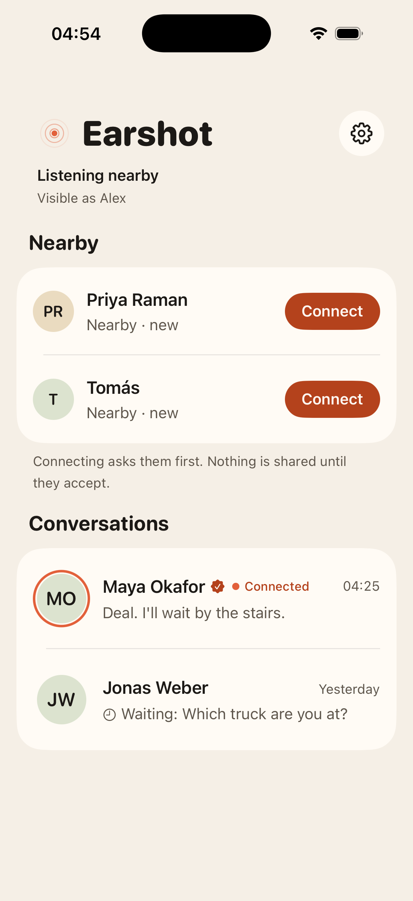
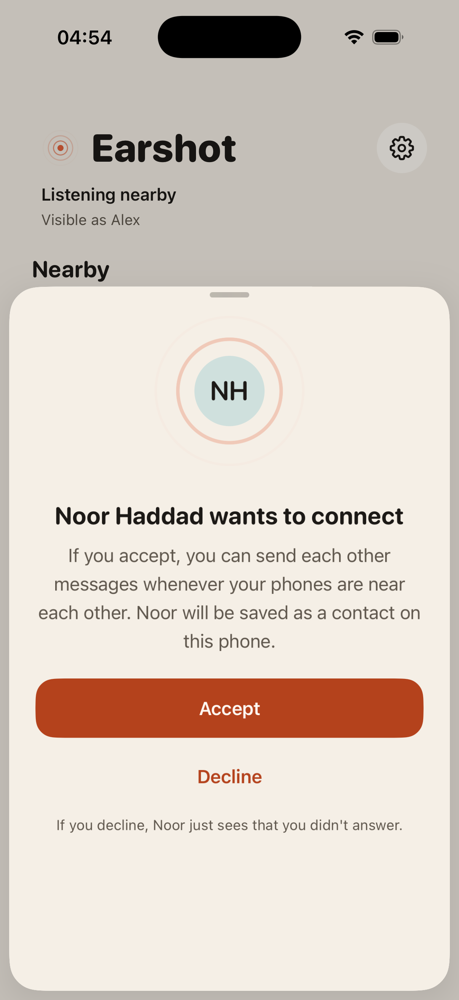
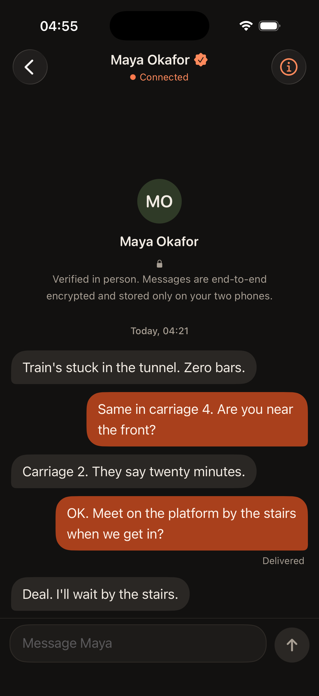
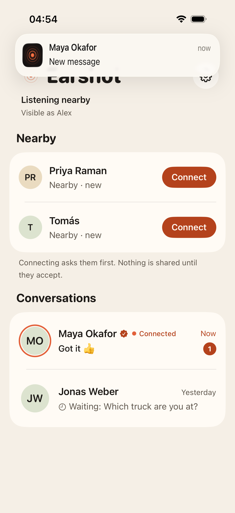

# Earshot

**Text the people near you when the network is gone.**

Earshot is an iPhone app for sending text messages directly between nearby iPhones over
Bluetooth. No internet, no Wi‑Fi, no mobile signal, no account, no server. A message can
reach a phone that is locked in a pocket, and that phone shows a notification.

<p>
  
  
  
  
</p>

More screens and states are in [`docs/screenshots`](docs/screenshots).

## What it does

- **Finds people nearby** who have Earshot, and shows which of your saved contacts are in range.
- **Asks before connecting.** Tapping Connect sends a request with your name; nothing else
  is shared until the other person accepts.
- **Conversations with honest delivery states:** Waiting (not in range, will send by
  itself), Sending, Delivered (the other phone confirmed it stored the message), Not delivered.
- **Reconnects by itself** when a saved contact comes back into range, and re-sends what was waiting.
- **Background delivery and notifications** on real iPhones, within the limits iOS sets (below).
- **Private by design:** end-to-end encrypted between the two phones, stored only on those
  phones, no analytics, no tracking, nothing sent to anyone else.

## What iOS allows, stated plainly

| | |
| --- | --- |
| Range | Bluetooth range: one room, or a few tens of metres in the open. Less through walls and crowds. |
| Phone locked or app in the background | A contact nearby **with Earshot open** can reach you, and you get a notification. Expect seconds, sometimes up to a minute. |
| Both phones locked when they first meet | They do **not** find each other until one person opens Earshot. |
| App swiped away, or phone restarted | Nothing runs until Earshot is opened again. |
| Relaying through other phones | No. Direct only; this is not a mesh network. |

The full explanation, including the security design and what Earshot does *not* protect
against, is in [`docs/HOW_IT_WORKS.md`](docs/HOW_IT_WORKS.md).

## Project layout

| Path | What it is |
| --- | --- |
| `EarshotKit/` | Swift package with the whole engine: discovery, consent, encryption, delivery, reconnection, storage. No UI. |
| `EarshotKit/Sources/EarshotProbe/` | `earshot-probe`, a command-line Earshot peer for the Mac, used as the "second phone" in tests. |
| `Earshot/` | The SwiftUI app. |
| `EarshotUITests/` | UI tests, accessibility audit, screenshot capture, live-link test. |
| `Scripts/` | `e2e.sh` (Simulator ↔ Mac over a real link), `device-test.sh` (iPhone ↔ Mac over Bluetooth). |
| `project.yml` | [XcodeGen](https://github.com/yonaskolb/XcodeGen) description of the Xcode project. |

## Setup

Requirements: Xcode 26 or later, XcodeGen (`brew install xcodegen`). Deployment target is iOS 17.

```sh
xcodegen generate
open Earshot.xcodeproj
```

Pick a simulator or your iPhone and run. To run on an iPhone, choose your team under
Signing & Capabilities (you may need to change the bundle identifier to one you own).

### Try it without a second phone

- **Demo mode** (simulated neighbours running the real engine on an in-memory radio):
  add the launch argument `-demo populated` (or `firstRun`, `empty`). Add `-demoRequest`
  to receive a connection request two seconds after launch. Demo people only ever exist
  with this argument; the normal app never shows invented activity.
- **A real link to your Mac:** run the app in the Simulator and, in a terminal,
  `cd EarshotKit && swift run earshot-probe --name Probe --echo`. "Probe" appears under
  Nearby, accepts your request and echoes every message. (The Simulator has no Bluetooth,
  so Simulator builds use Wi‑Fi through MultipeerConnectivity. Everything above the radio
  layer is the same code.)

## Tests and checks

```sh
cd EarshotKit && swift test          # engine: 79 tests (crypto, consent, delivery, reconnection, adversaries, Bluetooth byte formats)
cd .. && xcodegen generate
xcodebuild -project Earshot.xcodeproj -scheme Earshot \
  -destination 'platform=iOS Simulator,name=iPhone 17 Pro' test   # 11 UI tests incl. accessibility audit
Scripts/e2e.sh                       # app in the Simulator <-> earshot-probe over a real radio link
```

## What has been verified, and what has not

Verified on this project's development machine:

- Engine unit and integration tests pass (79), including hostile-peer tests.
- The app builds for the Simulator and for a real iPhone (arm64, unsigned) with no warnings.
- 11 UI tests pass in the Simulator: onboarding, connecting, chatting, delivery states,
  out-of-range and walk-away handling, incoming request, notification explainer, a
  notification appearing and opening the right chat, and Xcode's accessibility audit in
  light and dark mode.
- A real radio link end to end (`Scripts/e2e.sh`): the app in the Simulator discovers
  `earshot-probe`, sends a request, both sides show the same safety code, an encrypted
  message is delivered and confirmed, and the reply arrives. This runs over
  MultipeerConnectivity, not Bluetooth.
- The Bluetooth layer was code-reviewed independently and its byte formats are unit-tested.

**Not yet verified — needs real hardware:**

The Bluetooth layer (`BluetoothTransport.swift`) has **not been run between physical
devices**. Until this checklist is done, treat background delivery as built to Apple's
documented rules but unproven:

1. `EARSHOT_TEAM=<your team id> Scripts/device-test.sh` installs the app on a connected
   iPhone and starts a Bluetooth partner on the Mac. Check: the Bluetooth prompt appears
   when tapping "Turn On Earshot"; "Mac Probe" appears; request, message, Delivered and the echo work.
2. Two iPhones: connect, exchange messages, walk apart until the link drops, walk back
   and confirm waiting messages are delivered.
3. Background: on phone B press the side button to lock it. From phone A (Earshot open)
   send a message. Confirm B shows a notification and A shows Delivered. Note how long it takes.
4. Lock both phones, bring them together, confirm nothing happens until one opens Earshot (expected).
5. Swipe Earshot away on B, send from A: the message should stay Waiting (expected).
6. Switch Bluetooth off and on, and refuse the Bluetooth permission, and check the status card each time.
7. Measure practical range indoors and outdoors.

## Privacy

- No account, no server, no analytics, no crash reporting, no third-party code.
- Permissions: **Bluetooth** (asked when you switch Earshot on) and, optionally,
  **Notifications** (asked after your first contact connects). Nothing else.
- Your display name is readable by nearby Earshot phones only while "Visible to people
  nearby" is on. The device name is never used.
- Notifications are created on the phone itself and show only the sender's name unless
  you turn on message text.
- Messages and keys never leave the two phones and are excluded from backups.
- The encryption has not had an independent security audit. See the "does not protect
  against" section of [`docs/HOW_IT_WORKS.md`](docs/HOW_IT_WORKS.md).

## Notes

Earshot is an independent project. It is not made by, affiliated with or endorsed by Apple.
No licence has been chosen yet; add one before accepting contributions or distributing builds.
