<p align="center">
  
</p>

<h1 align="center">Earshot</h1>

<p align="center"><strong>Text the people near you when the network is gone.</strong></p>

<p align="center">
  <picture>
    <source media="(prefers-color-scheme: dark)" srcset="docs/showcase/hero.png">
    <source media="(prefers-color-scheme: light)" srcset="docs/showcase/hero-light.png">
    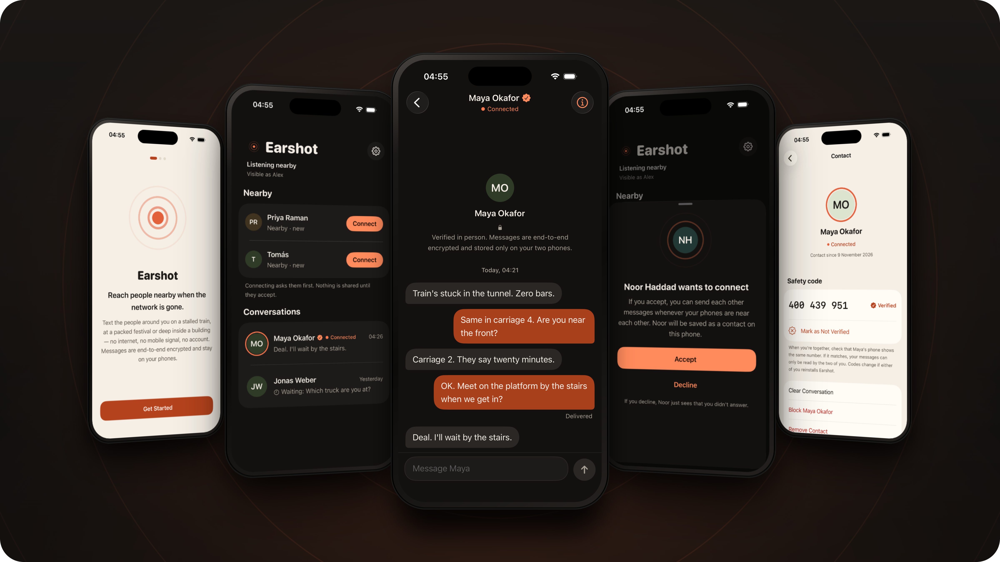
  </picture>
</p>

Earshot is an iPhone app for sending text messages directly between nearby iPhones over
Bluetooth. No internet, no Wi‑Fi, no mobile signal, no account, no server. A message can
reach a phone that is locked in a pocket, and that phone shows a notification. There is
also a [web version](#web-version) for Chrome and Edge on computers and Android phones.

## What it does

- **Finds people nearby** who have Earshot, and shows which of your saved contacts are in range.
- **Asks before connecting.** Tapping Connect sends a request with your name; nothing else
  is shared until the other person accepts.
- **Conversations with honest delivery states:** Waiting (not in range, will send by
  itself), Sending, Delivered (the other phone confirmed it stored the message), Not delivered.
- **Reconnects by itself** when a saved contact comes back into range, and re-sends what was waiting.
- **Photos**, one at a time, while you are connected: shrunk to about 150 KB with location
  and camera details removed, sent in small encrypted pieces with a progress ring, and
  "Delivered" only once the other phone has received, checked and saved the whole photo.
  Expect a few seconds to about half a minute per photo (an expectation, not yet measured
  between two phones). No video, and no camera button yet.
- **Light formatting**: `*bold*`, `_italic_`, `~strikethrough~`, `` `code` ``, and tappable
  web links, email addresses and phone numbers. Display only: the raw text is what travels,
  so older versions read every message. Links open only when tapped; no previews are fetched.
- **Background delivery and notifications** on real iPhones, within the limits iOS sets (below).
- **Private by design:** end-to-end encrypted between the two phones, stored only on those
  phones, no analytics, no tracking, nothing sent to anyone else.

<p align="center">
  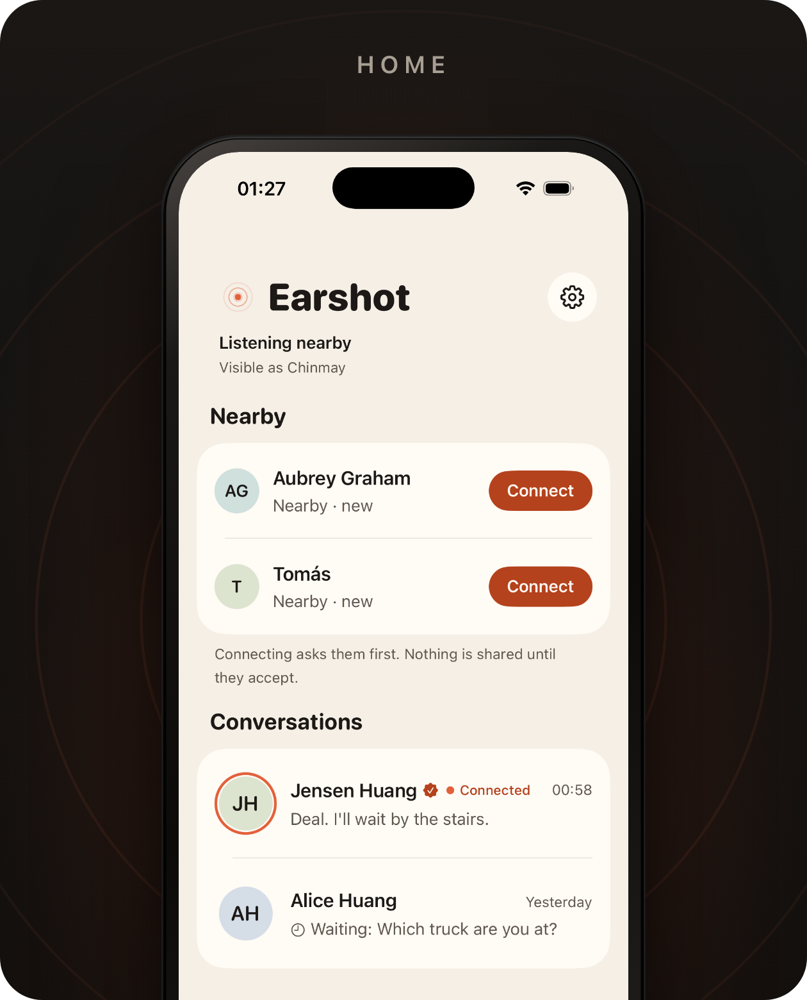
  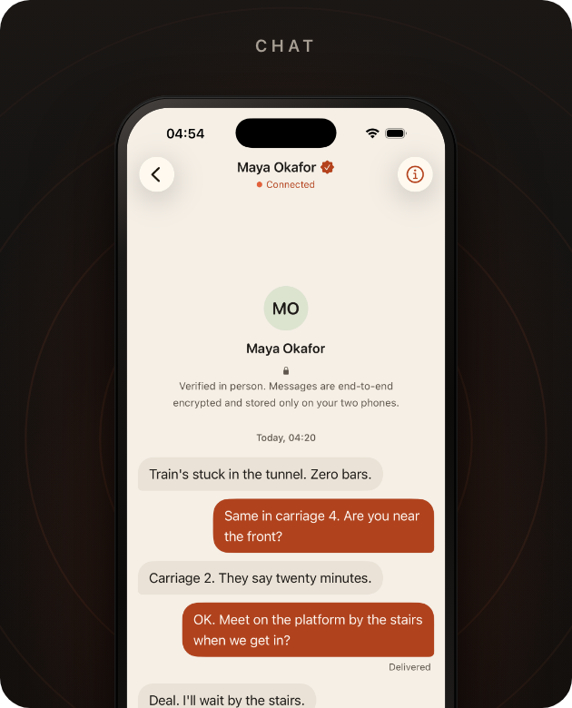
  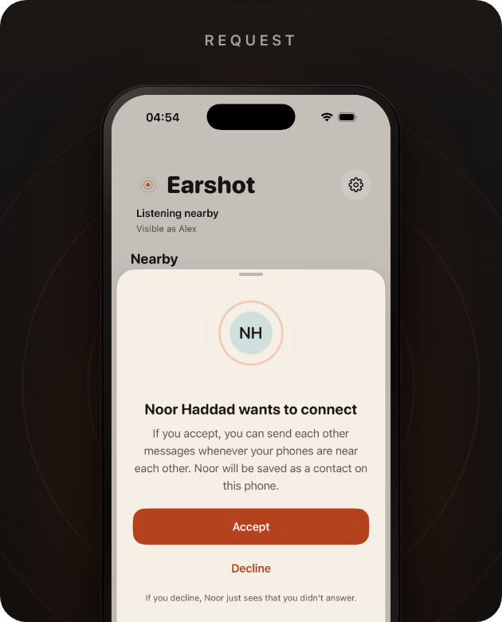
</p>
<p align="center">
  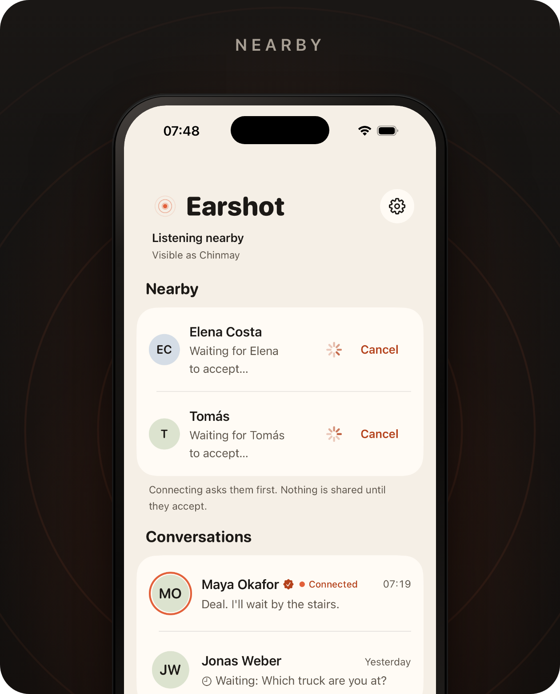
  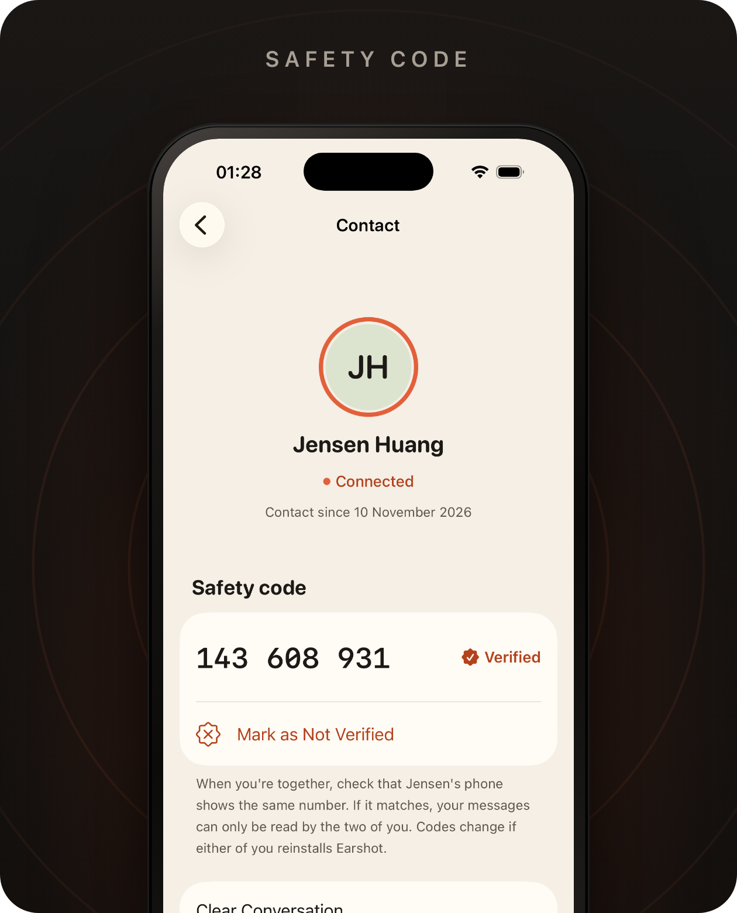
  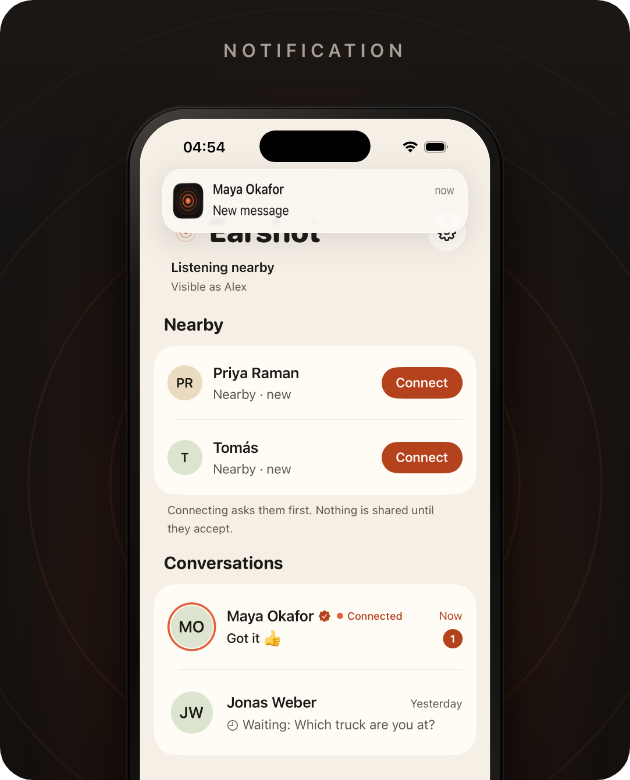
</p>
<p align="center">
  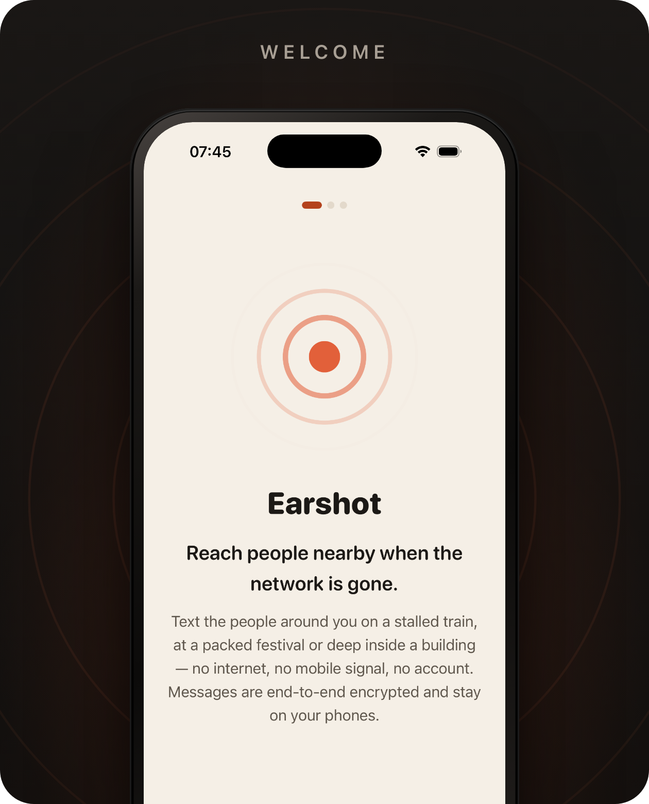
  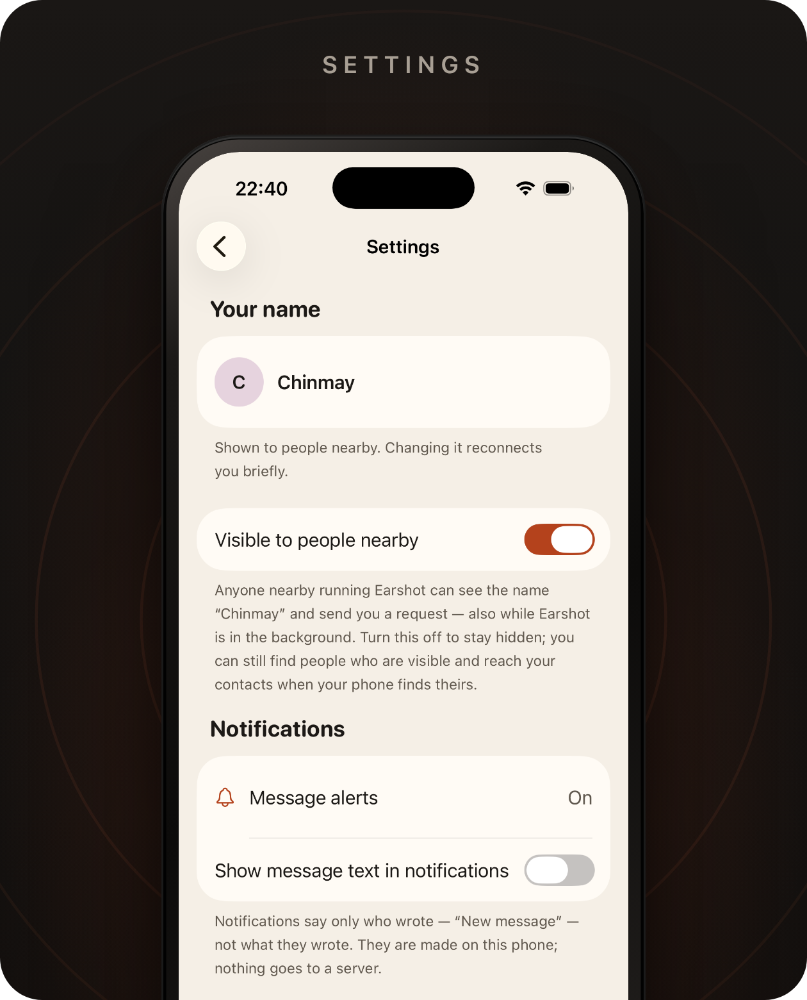
  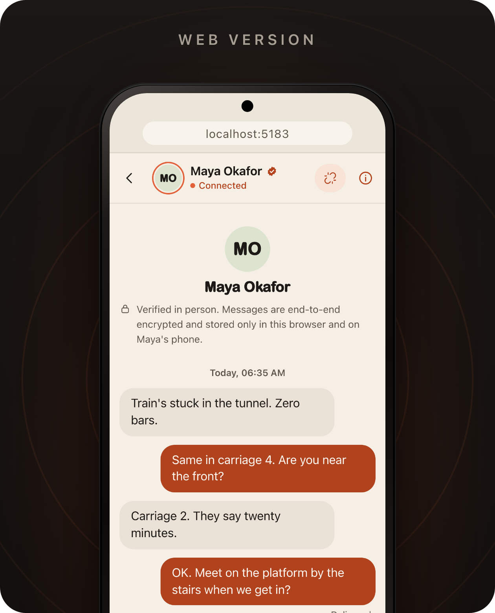
</p>

Photos and formatting:

<p align="center">
  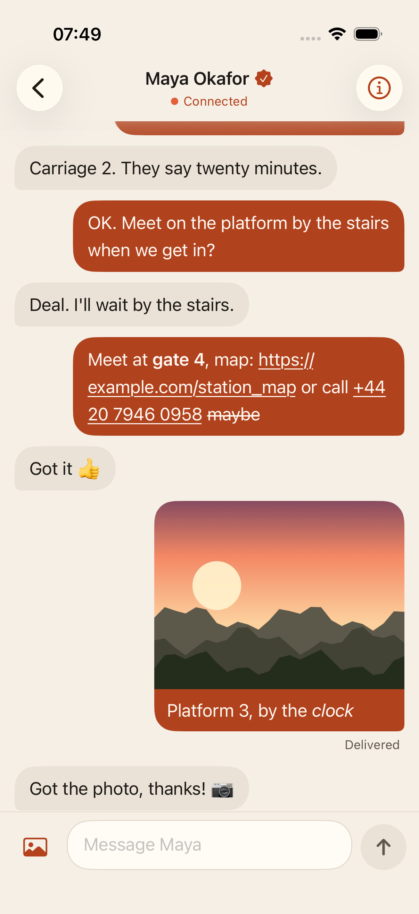
  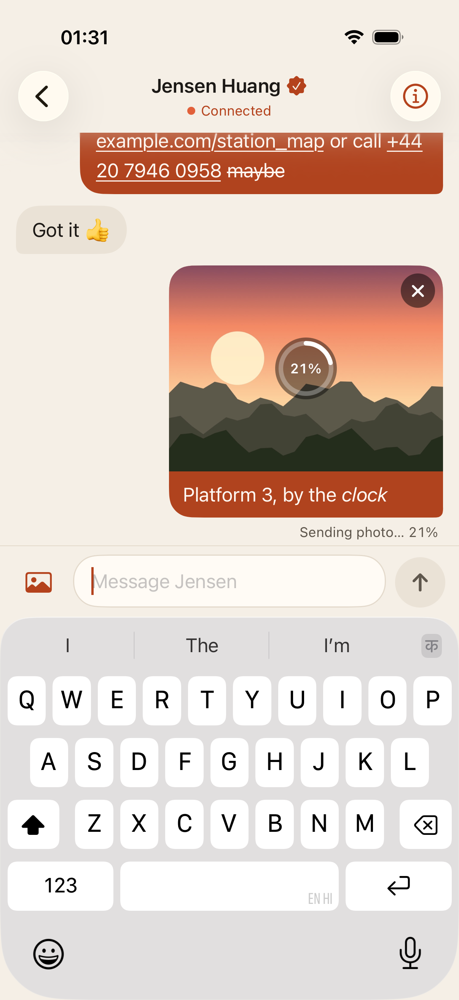
  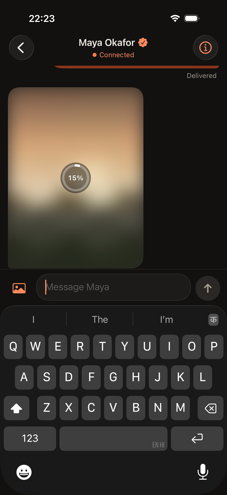
  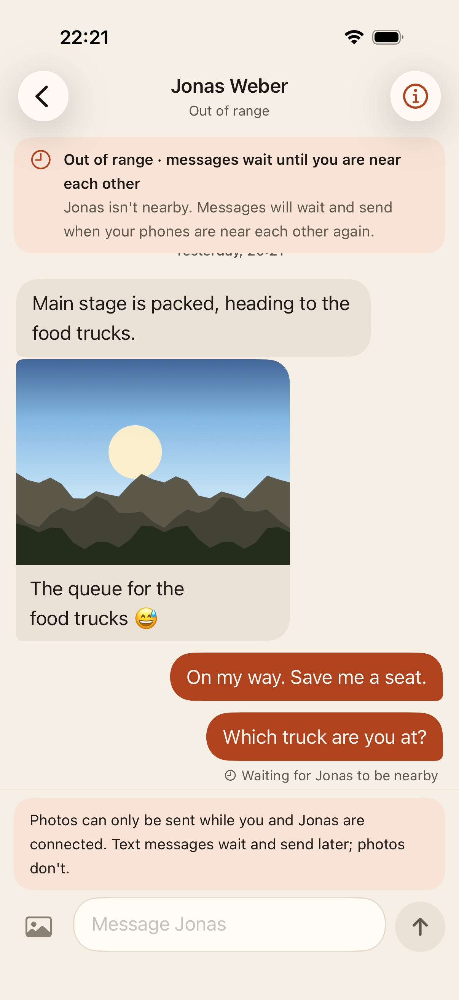
</p>

More screens and states are in [`docs/screenshots`](docs/screenshots).

<p align="center">
  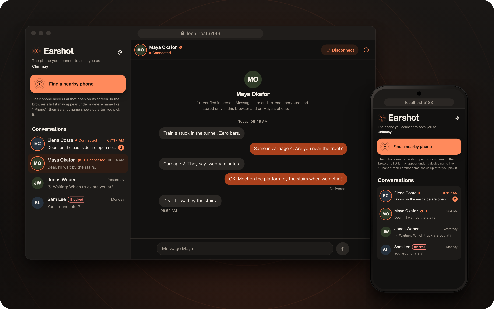
</p>

The web version runs in Chrome or Edge on a computer or an Android phone and talks to a
nearby iPhone running Earshot over Bluetooth, with the same encryption and the same
delivery states. See [Web version](#web-version) for what it can and cannot do.

## What iOS allows, stated plainly

| | |
| --- | --- |
| Range | Bluetooth range: one room, or a few tens of metres in the open. Less through walls and crowds. |
| Phone locked or app in the background | A contact nearby **with Earshot open** can reach you, and you get a notification. Expect seconds, sometimes up to a minute. |
| Both phones locked when they first meet | They do **not** find each other until one person opens Earshot. |
| App swiped away, or phone restarted | Nothing runs until Earshot is opened again. |
| Relaying through other phones | No. Direct only; this is not a mesh network. |
| Photos | Only while connected, one at a time, roughly 5–50 KB/s (expected, not measured). If the link drops the photo starts again when you reconnect. No video. |

The full explanation, including the security design and what Earshot does *not* protect
against, is in [`docs/HOW_IT_WORKS.md`](docs/HOW_IT_WORKS.md).

## Web version

The `web/` folder holds a web version of Earshot. It uses the same message format and
encryption as the iPhone app, so a browser and an iPhone can talk to each other.

- **Where it runs:** Chrome, Edge and other Chromium browsers on a computer or an Android
  phone, using Web Bluetooth. Safari, Firefox and every browser on iPhone and iPad cannot
  use Bluetooth from a web page; on an iPhone, use the app. The page must be served from a
  secure address (`https`, or `localhost` while developing).
- **The browser always starts the connection.** A web page cannot announce itself, so
  phones cannot find it and nobody can send it a request. You click "Find a nearby phone",
  pick the phone in the browser's own list, and the person holding it taps Accept.
- **The phone must have Earshot open on its screen** to show up in that list. The list
  may call it something like "iPhone"; the person's Earshot name appears after you pick it.
  Once connected, the phone can be locked and the link stays open.
- **Closing the tab ends the connection.** The page cannot receive anything while it is
  closed. Messages you write while not connected show Waiting and send when you reconnect,
  which is one click and one pick in the list.
- Messages, contacts and keys are stored only in that browser's storage for the site.

Run it:

```sh
cd web
npm install
npm run dev          # then open http://localhost:5183
```

To try it without a phone, open `http://localhost:5183/?demo=populated` (also
`?demo=empty` and `?demo=firstRun`). Demo people exist only with that address.

**Honest status:** the web engine has been checked byte for byte against the Swift engine
on a Mac (shared test vectors, and a live test that runs the TypeScript engine against the
real Swift code through `earshot-probe --pipe`, with only the radio simulated). A browser
talking to a real iPhone over real Bluetooth has **not yet been verified by hand**.

## Project layout

| Path | What it is |
| --- | --- |
| `EarshotKit/` | Swift package with the whole engine: discovery, consent, encryption, delivery, reconnection, storage. No UI. |
| `EarshotKit/Sources/EarshotProbe/` | `earshot-probe`, a command-line Earshot peer for the Mac, used as the "second phone" in tests. |
| `Earshot/` | The SwiftUI app. |
| `EarshotUITests/` | UI tests, accessibility audit, screenshot capture, live-link test. |
| `web/` | The web version (TypeScript, React, Vite): its own engine using Web Bluetooth, the interface, unit tests and browser tests. |
| `docs/screenshots/` | App and web screenshots captured by the UI tests. |
| `docs/showcase/` | The images at the top of this page, made from those screenshots. |
| `Tools/showcase/` | The script that makes `docs/showcase/` (see below). |
| `Scripts/` | `e2e.sh` (Simulator ↔ Mac over a real link, including a photo each way), `device-test.sh` (iPhone ↔ Mac over Bluetooth). |
| `project.yml` | [XcodeGen](https://github.com/yonaskolb/XcodeGen) description of the Xcode project. |

## Setup

Requirements: Xcode 26 or later, XcodeGen (`brew install xcodegen`). Deployment target is iOS 17.

```sh
xcodegen generate
open Earshot.xcodeproj
```

Pick a simulator or your iPhone and run. To run on an iPhone, choose your team under
Signing & Capabilities (you may need to change the bundle identifier to one you own).

### Try it without a second phone

- **Demo mode** (simulated neighbours running the real engine on an in-memory radio):
  add the launch argument `-demo populated` (or `firstRun`, `empty`). Add `-demoRequest`
  to receive a connection request two seconds after launch. Demo people only ever exist
  with this argument; the normal app never shows invented activity.
- **A real link to your Mac:** run the app in the Simulator and, in a terminal,
  `cd EarshotKit && swift run earshot-probe --name Probe --echo`. "Probe" appears under
  Nearby, accepts your request and echoes every message. Add `--photo-echo` to answer every
  photo with a generated test picture, and `--send-photo` to send one as soon as you connect.
  With `EARSHOT_BT_DEBUG=1` it prints a speed line (bytes, seconds, KB/s) for each photo.
- **Photos in the Simulator or UI tests:** the debug launch argument `-useSamplePhoto` makes
  the photo button attach a built-in picture instead of opening the system photo picker. (The Simulator has no Bluetooth,
  so Simulator builds use Wi‑Fi through MultipeerConnectivity. Everything above the radio
  layer is the same code.)

## Tests and checks

```sh
cd EarshotKit && swift test          # engine: 152 tests (crypto, consent, delivery, reconnection, adversaries, Bluetooth byte formats, formatting, photos)
cd .. && xcodegen generate
xcodebuild -project Earshot.xcodeproj -scheme Earshot \
  -destination 'platform=iOS Simulator,name=iPhone 17 Pro' test   # 16 UI tests incl. accessibility audit
Scripts/e2e.sh                       # app in the Simulator <-> earshot-probe over a real radio link
```

Web version (from `web/`):

```sh
npm run typecheck                    # TypeScript checks
npm test                             # 69 unit tests, including the checks against the Swift engine
npx playwright test                  # 47 browser tests (uses ports 5183 and 5184)
```

### Showcase images

The iPhone screenshots in `docs/screenshots/` are retaken with `Scripts/screenshots.sh`
(it uses its own "Earshot Shots" simulator; see the top of the script).
The images at the top of this page are made from those screenshots by one command, run
from the repository root after `npm install` in `web/`:

```sh
node Tools/showcase/generate.mjs
```

Which screenshot goes where is set in the `CONFIG` object at the top of
`Tools/showcase/generate.mjs`. More detail is in [`Tools/showcase/README.md`](Tools/showcase/README.md).

## What has been verified, and what has not

Verified on this project's development machine:

- Engine unit and integration tests pass (152), including hostile-peer tests for
  photos, old↔new compatibility in both roles and over reconnection, metadata removal, and a
  migration test that loads data saved by the previous version.
- The app builds for the Simulator and for a real iPhone (arm64, unsigned) with no warnings.
- 16 UI tests pass in the Simulator (the notification-banner one runs only where
  notifications are allowed for Earshot). New ones cover formatting with a tappable link,
  sending a photo through to Delivered, the full-screen viewer, the share sheet opening
  with no permission prompt, and the photo button explaining why it is unavailable. The
  earlier ones cover onboarding, connecting, chatting, delivery states,
  out-of-range and walk-away handling, incoming request, notification explainer, a
  notification appearing and opening the right chat, and Xcode's accessibility audit in
  light and dark mode.
- A real radio link end to end (`Scripts/e2e.sh`): the app in the Simulator discovers
  `earshot-probe`, sends a request, both sides show the same safety code, an encrypted
  message is delivered and confirmed, and the reply arrives. Then a photo goes each way
  (the probe checks size and hash; the app shows Delivered and the probe's picture). This
  runs over MultipeerConnectivity, not Bluetooth.
- The Bluetooth layer was code-reviewed independently and its byte formats are unit-tested.

Photos and formatting have **not** been tried on real phones or over Bluetooth yet. They
were checked with the engine tests, UI tests in demo mode, and `earshot-probe` ↔ `earshot-probe`
and Simulator ↔ probe over MultipeerConnectivity (see the photo checklist below).

Verified on real hardware (12 November 2026, iPhone 17 Pro and iPhone 15, plus a Mac):

- iPhone to Mac over Bluetooth LE: the phone found `earshot-probe --bluetooth`, sent a
  request, both sides agreed on a safety code, and three messages were received by the
  Mac and their echoes confirmed as delivered (checked in the probe's log).
- iPhone to iPhone over Bluetooth LE: discovery, request and consent, and messages in
  both directions, with no Mac involved (observed by hand).
- Background delivery: with the two phones connected, one phone was locked, the other
  sent a message, the locked phone showed a notification and the sender showed Delivered
  (observed by hand).
- Tapping a message notification opens that conversation (observed by hand, after a fix:
  the first build stopped the app on a tap).
- Photos sent in both directions between the two iPhones over Bluetooth LE (observed by
  hand; transfer time and speed not yet measured).

**Not yet verified — still needs checking on real phones:**

1. Walk apart until the link drops, walk back, and confirm waiting messages are delivered.
2. Send to a phone whose Earshot was sent to the home screen a minute or more earlier and
   then locked (the link has to survive, or be re-made by the phone that is open).
3. Lock both phones, bring them together, confirm nothing happens until one opens Earshot (expected).
4. Swipe Earshot away on B, send from A: the message should stay Waiting (expected).
5. Switch Bluetooth off and on, and refuse the Bluetooth permission, and check the status card each time.
6. The relaunch by iOS after it removes the app from memory (state restoration).
7. Measure practical range indoors and outdoors, and how long a 2,000-character message takes.
8. Photos, on two phones over Bluetooth:
   - Send a photo from A to B and from B to A; both show progress, then "Delivered", and the
     photo opens full screen. Write down the size and the seconds it took (with
     `EARSHOT_BT_DEBUG=1` from Xcode the log prints KB/s), for both directions.
   - Lock B with Earshot in the background, send a photo from A: B shows a "Photo"
     notification (or "New message"), A shows "Delivered".
   - Start a photo, then walk out of range halfway: A shows "Waiting", B shows nothing left
     over; walk back: the photo starts again and is delivered once.
   - Tap ✕ while sending: A shows "Cancelled", B's placeholder disappears.
   - Send a text while a photo is on its way: the text arrives first.
   - Long-press a link in a message and copy it; tap it and check Safari opens.

`EARSHOT_TEAM=<your team id> Scripts/device-test.sh` installs the app on a connected
iPhone and starts a Bluetooth partner on the Mac for these checks.

## Privacy

- No account, no server, no analytics, no crash reporting, no third-party code.
- Permissions: **Bluetooth** (asked when you switch Earshot on) and, optionally,
  **Notifications** (asked after your first contact connects). Nothing else: photos are
  picked with Apple's photo picker, which needs no permission, and there is no camera access.
- Photos are stripped of location, camera and date details before they are sent, and are
  stored only on the two phones, protected like messages and excluded from backups.
- No link previews: Earshot makes no network requests; a link opens only when you tap it.
- Your display name is readable by nearby Earshot phones only while "Visible to people
  nearby" is on. The device name is never used.
- Notifications are created on the phone itself and show only the sender's name unless
  you turn on message text.
- Messages and keys never leave the two phones and are excluded from backups.
- The encryption has not had an independent security audit. See the "does not protect
  against" section of [`docs/HOW_IT_WORKS.md`](docs/HOW_IT_WORKS.md).

## Notes

Earshot is an independent project. It is not made by, affiliated with or endorsed by Apple.

## Licence

Earshot is released under the [MIT Licence](LICENSE): you may use, change and share the
code, including commercially, as long as the copyright notice stays with it.
